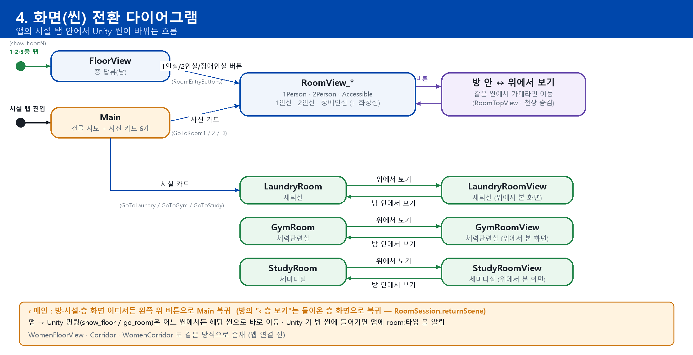
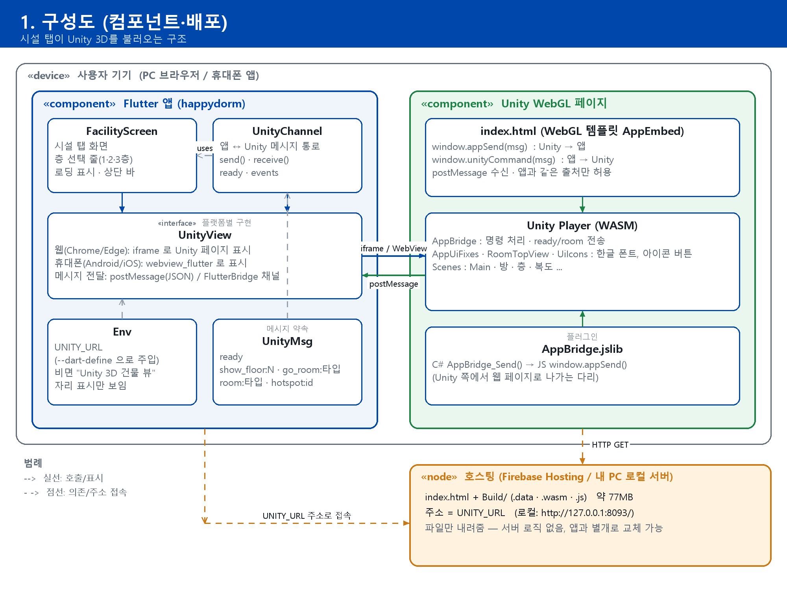

# 행복기숙사 Unity 3D 안내 (Unity 파트)

기숙사 **건물 지도 → 방 안(1인칭) → 위에서 보기 → 층 평면도**를 3D로 둘러보는 Unity 프로젝트의 **기능과 코드 정리**입니다.
Unity를 **WebGL**로 빌드해서 Flutter 앱의 **시설 탭**에 넣어 쓰고(웹은 iframe, 휴대폰은 WebView), 앱과는 문자열 메시지로 대화합니다.

> 이 저장소는 **코드와 문서**만 담았습니다. 3D 모델·텍스처·씬 파일이 들어 있는 전체 프로젝트(수백 MB)는 담지 않았습니다. → [이 저장소에 없는 것](#이-저장소에-없는-것)

| | |
|---|---|
| Unity | **6000.3.22f1** · URP · 새 Input System(`InputSystem` 패키지) |
| 대상 | WebGL(앱 시설 탭), 에디터/PC에서도 동작 |
| 앱 쪽 | Flutter(`lib/features/facility`) — 웹 iframe · 휴대폰 WebView |

---

## 1. 무엇을 할 수 있나

| 기능 | 설명 |
|---|---|
| **건물 지도 (Main)** | 건물 3D 지도 위에 시설 사진 카드 6개(1인실·2인실·장애인실·세미나실·체력단련실·세탁실). 카드를 누르면 해당 방으로 이동 |
| **방 둘러보기** | 위치는 고정, 드래그로 시선만 돌리는 로드뷰 방식. 휠/두 손가락 핀치로 확대·축소 |
| **화장실 이동** | 침실에서 "화장실" 버튼 → 카메라가 문을 지나 화장실까지 부드럽게 이동, "방으로"로 복귀 |
| **위에서 보기** | 천장을 숨기고 카메라를 방 바로 위로 올려 방 전체를 보여줌. 침실 3종 + 세탁실·체력단련실·세미나실 모두 같은 버튼 |
| **층 평면도** | 천장 없는 층 단면을 궤도 카메라로 이동·기울기·회전·줌 (남/여 층, 복도 포함) |
| **앱 연동** | 앱이 보내는 `show_floor:N`, `go_room:<종류>`를 받아 화면을 바꾸고, 방에 들어오면 `room:<종류>`를 앱에 알림 |
| **처음 쓰는 사람 안내** | 방에 들어갈 때마다 "터치로 화면 제어"를 약 2초 보여줌 |

### 조작법

| | 마우스 | 터치 |
|---|---|---|
| 방 둘러보기 | 왼쪽 드래그 | 한 손가락 드래그 |
| 확대/축소 | 휠 | 두 손가락 핀치 |
| 층 평면도 이동 | 왼쪽 드래그 | 한 손가락 |
| 층 평면도 기울기·회전 | 오른쪽 드래그 | 두 손가락 드래그 |
| 시점 초기화 | `R` | — |

버튼 위에서 시작한 드래그는 카메라를 움직이지 않습니다(`PointerGate`).

---

## 2. 화면 흐름



- 시작 씬은 **`Main`** 입니다. 방에서 왼쪽 위 **← 버튼**을 누르면 `Main`으로(층 화면에서 들어온 경우엔 그 층으로) 돌아갑니다.
- 앱의 층 탭을 누르면 앱이 `show_floor:N`을 보내 `FloorView`가 열립니다.
- 씬 14개: `Main`, `FloorView`, `WomenFloorView`, `Corridor`, `WomenCorridor`, `RoomView_1Person`, `RoomView_2Person`, `RoomView_Accessible`, `GymRoom`, `GymRoomView`, `LaundryRoom`, `LaundryRoomView`, `StudyRoom`, `StudyRoomView`
  (`*View` = 같은 방을 위에서 본 씬)

---

## 3. 구조



### 앱 ↔ Unity 메시지

메시지는 문자열 한 줄 `이름` 또는 `이름:값` 입니다.

| 방향 | 메시지 | 뜻 |
|---|---|---|
| Unity → 앱 | `ready` | 첫 씬이 떴다. 이 뒤부터 앱이 명령을 보냄 |
| Unity → 앱 | `room:1person` / `room:2person` / `room:accessible` | 방 화면에 들어왔다 (씬이 로드될 때 자동 전송) |
| Unity → 앱 | `hotspot:<id>` | 시설을 눌렀다 *(id 목록은 아직 정해지지 않음)* |
| 앱 → Unity | `show_floor:<n>` | n층을 보여줘 *(지금은 층 구분 없이 `FloorView`)* |
| 앱 → Unity | `go_room:1person` / `2person` / `accessible` | 해당 방 화면을 열어줘 |

전달 경로는 호스팅 페이지(`WebGLTemplates/AppEmbed/index.html`)가 알아서 고릅니다.

| | Unity → 앱 | 앱 → Unity |
|---|---|---|
| 웹(iframe) | `parent.postMessage('{"type":"unity","msg":"…"}')` | `postMessage('{"type":"app","msg":"…"}')` |
| 휴대폰(WebView) | `FlutterBridge.postMessage('…')` | `window.unityCommand('…')` |

자세한 시퀀스는 [시퀀스 다이어그램](docs/diagrams/2-sequence.png), 연결 방법은 [`docs/app-integration.md`](docs/app-integration.md)에 있습니다.

### 실행 중 자동으로 만들어지는 부분

앱 연결 코드는 **씬 파일을 고치지 않고** 코드로 붙습니다.

1. `AppBridge`가 게임 시작 전에 자동 생성(`RuntimeInitializeOnLoadMethod`)되고 `DontDestroyOnLoad`로 살아남습니다.
2. 씬이 로드될 때마다 `AppUiFixes.Apply(scene)`가 호출되어 **한글 글꼴 · 아이콘 버튼 · 입장 안내**를 붙입니다.
3. 침실 씬이면 `RoomTopView`가, 시설 방이면 위에서 보기 전환 버튼이 생깁니다.

---

## 4. 폴더 구조

```
dormitory-unity-3d/
├─ README.md
├─ docs/
│  ├─ app-integration.md     앱(Flutter) ↔ Unity 연결: 메시지·구성 파일·빌드 방법
│  ├─ scripts.md             스크립트별 기능과 알고리즘
│  └─ diagrams/              구성도·시퀀스·클래스·화면전환·유스케이스·스크립트 요약(PNG)
├─ src/
│  ├─ Scripts/               실행 중에 쓰이는 C# (Assets/Scripts)
│  │  └─ AppBridge/          앱 연결·UI 보정·아이콘·위에서 보기·입장 안내
│  ├─ Editor/                빌드 스크립트·화면 맞춤 도구·씬/프리팹 생성기 (Assets/Editor)
│  └─ WebGL/
│     ├─ Plugins/AppBridge.jslib                    C# → 웹 페이지
│     └─ WebGLTemplates/AppEmbed/index.html         Unity 로딩 + 앱 메시지 중계 페이지
└─ tools/
   └─ serve_nocache.py       로컬 테스트용 정적 서버(캐시 끔)
```

`src/` 안의 경로는 Unity 프로젝트의 `Assets/` 아래 경로와 같은 이름입니다. (예: `src/Scripts` → `Assets/Scripts`)

---

## 5. 핵심 코드 안내

자세한 알고리즘은 [`docs/scripts.md`](docs/scripts.md), 클래스 관계는 [클래스 다이어그램](docs/diagrams/3-class.png)을 보세요.

### 앱 연결 · UI (`src/Scripts/AppBridge`)

| 파일 | 역할 |
|---|---|
| [`AppBridge.cs`](src/Scripts/AppBridge/AppBridge.cs) | 앱과의 메시지 통로. `OnCommand`로 명령 처리, `Send`로 `ready`/`room:` 전송 |
| [`AppUiFixes.cs`](src/Scripts/AppBridge/AppUiFixes.cs) | 씬마다 한글 글꼴, 동그란 아이콘 버튼(← 뒤로가기, 위에서 보기), 입장 안내 붙이기 |
| [`RoomTopView.cs`](src/Scripts/AppBridge/RoomTopView.cs) | 침실의 "위에서 보기": 천장 숨김 + 방 전체가 들어오는 거리 계산 + 0.45초 이동 |
| [`UiIcons.cs`](src/Scripts/AppBridge/UiIcons.cs) | 아이콘을 이미지 파일 없이 코드로 그림(←, 평면도, 눈, 물방울, 문) |
| [`FirstEntryHint.cs`](src/Scripts/AppBridge/FirstEntryHint.cs) | 방 입장마다 "터치로 화면 제어"를 2초 보여줌(터치를 가로채지 않음) |

### 방 · 층 · 공통 (`src/Scripts`)

| 파일 | 역할 |
|---|---|
| [`RoomLookCamera.cs`](src/Scripts/RoomLookCamera.cs) | 1인칭 둘러보기 카메라(드래그 = 시선 회전, 핀치 = FOV), 경로 이동 `MoveAlong` |
| [`RoomViewController.cs`](src/Scripts/RoomViewController.cs) | 방 화면의 "화장실"/"방으로"/뒤로가기 버튼 |
| [`FloorViewCamera.cs`](src/Scripts/FloorViewCamera.cs) | 층 평면도 궤도 카메라(이동·기울기·회전·줌) |
| [`RoomEntryButtons.cs`](src/Scripts/RoomEntryButtons.cs) · [`RoomSession.cs`](src/Scripts/RoomSession.cs) | 층 화면에서 방으로 들어갈 때 방 이름·돌아갈 씬 전달 |
| [`SceneChanger.cs`](src/Scripts/SceneChanger.cs) | 버튼 `OnClick`에 연결하는 씬 이동 함수 모음 |
| [`UiUtil.cs`](src/Scripts/UiUtil.cs) | `EventSystem` 보장, 한글 글꼴 생성, UI 위 포인터 판정(`PointerGate`) |
| [`SafeAreaFitter.cs`](src/Scripts/SafeAreaFitter.cs) | 노치·시스템 바를 피해 UI 영역 맞추기 |
| [`KoreanFont.cs`](src/Scripts/KoreanFont.cs) | 캔버스 아래 `Text`를 한글 글꼴로 교체 |
| `HoldButtonController.cs` · `CarMove.cs` · `CloudSpawner.cs` · `CloudMover.cs` | Main 지도의 눌림 효과와 장식(자동차·구름) |

### 에디터 도구 (`src/Editor`)

메뉴 `Tools > Dorm` 아래에 있습니다.

| 메뉴 | 파일 | 하는 일 |
|---|---|---|
| Build WebGL (for app) | `WebGLBuild.cs` | 앱용 WebGL 빌드(씬 등록, 템플릿·압축·스트리핑 설정) |
| Fit Main screen UI to any screen size | `MainScreenFit.cs` | Main 캔버스를 "화면 크기에 맞춤(1440×2560, Expand)"으로 바꿔 카드가 잘리지 않게 |
| Match facility title size to room views | `FacilityTitleFit.cs` | 세탁실·체력단련실·세미나실 제목 크기를 침실과 맞춤 |
| Fit facility camera button to any screen size | `FacilityCameraButtonFit.cs` | 시설 씬의 카메라 버튼이 작은 화면에서 밖으로 나가지 않게 |
| Shrink textures for WebGL | `WebGLTextureOptimizer.cs` | WebGL 전용 텍스처 축소(PC/Android 설정은 그대로) |

그 밖에 방·화장실·복도·휴게실·층 단면을 **코드로 생성**하는 빌더(`*Builder.cs`, `NavBuilder.cs`, `RebuildAll.cs`)와 씬 점검 도구(`SceneAudit.cs`: 면 겹침·가구 관통·누락 메시 검사)가 있습니다.

---

## 6. 빌드와 실행

### WebGL 빌드

1. Unity Hub에서 **6000.3.22f1** 에 **Web Build Support** 모듈을 설치합니다(1회).
2. 메뉴 `Tools > Dorm > Build WebGL (for app)` → 결과가 `Builds/WebGL`에 나옵니다.
   명령줄로는:
   ```
   Unity -batchmode -quit -projectPath <프로젝트 경로> -executeMethod WebGLBuild.BuildFromCommandLine -outDir <결과 폴더>
   ```
3. 빌드 설정(코드 `WebGLBuild.cs`에 들어 있음): 템플릿 `PROJECT:AppEmbed`, 압축 **Disabled**(호스팅이 따로 압축), 예외 지원 없음, 코드 스트리핑 High, ASTC 텍스처, 스플래시 끔.
4. 시작 씬은 `Main`, 이어서 시설 씬 6개와 층·복도·방 흐름 씬 7개가 등록됩니다.

처음 빌드는 오래 걸립니다(코드가 바뀌면 약 20분 이상, 씬만 바뀌면 1분 이내).

### 내 PC에서 3D만 열어 보기

```
python tools/serve_nocache.py <WebGL 빌드 폴더> 8093
```

브라우저에서 `http://127.0.0.1:8093/` 을 열면 Unity 단독으로 동작합니다. 앱 없이도 방 이동·위에서 보기·둘러보기를 확인할 수 있습니다.

`serve_nocache.py`는 `python -m http.server`와 달리 **캐시를 끄고**(새 빌드와 옛 `index.html`이 섞여 "Unknown data format"이 나는 것을 막음), Windows에서 **같은 포트를 두 서버가 나눠 쓰지 못하게** 합니다.

### 앱과 함께 돌리기

앱을 `--dart-define=UNITY_URL=http://127.0.0.1:8093/` 로 빌드·실행하면 시설 탭에 이 Unity가 붙습니다. `UNITY_URL`이 비어 있으면 시설 탭에는 "Unity 3D 건물 뷰" 자리 표시만 나옵니다. 자세한 방법은 [`docs/app-integration.md`](docs/app-integration.md)를 보세요.

---

## 이 저장소에 없는 것

- 3D 모델 · 텍스처 · 머티리얼 · 씬(`.unity`) · 프리팹 → 전체 Unity 프로젝트에 있습니다(약 630MB, `Library` 제외 압축).
- `Assets/Resources/KoreanFont.ttf` (Noto Sans KR, SIL OFL)
- Flutter 앱 코드(`lib/features/facility`) → 앱 저장소에 있습니다.

전체 프로젝트를 열려면 위 폴더 구조대로 `src/`의 파일을 프로젝트의 `Assets/` 아래에 넣고 Unity **6000.3.22f1**로 여세요.
